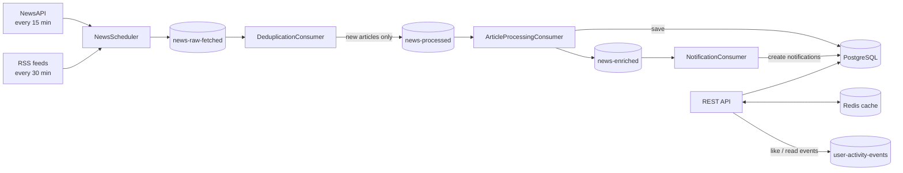

# News Aggregator: Backend

[](https://github.com/Arya089/news-aggregator/actions/workflows/deploy.yml)

An event-driven news aggregation backend built with **Spring Boot 3, Kafka, Redis and PostgreSQL**. It pulls articles from NewsAPI and RSS feeds on a schedule, pushes them through a multi-stage Kafka pipeline (dedupe, process, enrich, notify), and serves them through a JWT-secured REST API with Redis caching.

## Features

- **JWT authentication:** register, login, refresh token and logout, with role-based access (`USER`, `ADMIN`).
- **~28 REST endpoints:** articles, categories, trending, personalised feed, search and suggestions, likes, reads, bookmarks, notifications, user profile and preferences, sources, admin.
- **Live ingestion:** NewsAPI every 15 minutes (technology, sports, business, health, entertainment) and RSS feeds (BBC, NDTV, Times of India) every 30 minutes.
- **Kafka pipeline:** each stage is its own consumer group with manual acknowledgment (at-least-once delivery).
- **Deduplication:** an in-memory URL check, then a database check, backed by a unique constraint on `articles.url`.
- **Redis caching:** trending articles are cached (15-minute TTL) and evicted when likes or deletes change the data.
- **Idempotent interactions:** one row per user and article (unique `(user_id, article_id)`), so repeated likes or reads are not double-counted.
- **Integration boundary for an AI layer:** `news-enriched` and `user-activity-events` topics for a separate recommendation and summarisation service.
- **One-command setup:** the whole stack runs with Docker Compose.

## Architecture



| Topic | Produced by | Consumed by |
|---|---|---|
| `news-raw-fetched` | NewsScheduler (NewsAPI and RSS) | DeduplicationConsumer (`dedup-group`) |
| `news-processed` | DeduplicationConsumer | ArticleProcessingConsumer (`processing-group`) |
| `news-enriched` | ArticleProcessingConsumer | NotificationConsumer (`notification-group`) and downstream AI service |
| `user-activity-events` | REST API (likes and reads) | Downstream AI service |

## Tech stack

| Area | Technology |
|---|---|
| Language and framework | Java 17, Spring Boot 3.5, Maven |
| Persistence | PostgreSQL 15, Spring Data JPA / Hibernate |
| Security | Spring Security, JWT (JJWT 0.12), BCrypt |
| Messaging | Apache Kafka 7.4 (Confluent images) and Zookeeper, Spring for Apache Kafka |
| Caching | Redis 7, Spring Cache |
| Ingestion | NewsAPI over WebClient, RSS via Rome |
| DevOps | Docker (multi-stage build), Docker Compose, GitHub Actions |

## Getting started

### Prerequisites

- Docker Desktop (or Docker Engine with Compose)
- Git
- A free API key from [newsapi.org](https://newsapi.org)

### Run with Docker Compose

```bash
git clone https://github.com/Arya089/news-aggregator.git
cd news-aggregator
```

Create a `.env` file in the project root (it is gitignored):

```
POSTGRES_PASSWORD=choose_a_strong_password
NEWSAPI_KEY=your_newsapi_key
```

Start everything:

```bash
docker compose up --build -d
docker compose ps
```

All five containers (`app`, `postgres`, `redis`, `kafka`, `zookeeper`) should show `Up`. The app takes about 30 seconds to finish starting. The API is then available at `http://localhost:8080`.

Only ports `8080` (API) and `9092` (Kafka) are published. Postgres and Redis are reachable only inside the Docker network.

### Check that it works

```bash
# Register (POST with a JSON body)
curl -X POST http://localhost:8080/api/auth/register \
  -H "Content-Type: application/json" \
  -d '{"username":"demo","email":"demo@example.com","password":"Pass123"}'

# Log in, which returns accessToken and refreshToken
curl -X POST http://localhost:8080/api/auth/login \
  -H "Content-Type: application/json" \
  -d '{"username":"demo","password":"Pass123"}'

# Public endpoint
curl http://localhost:8080/api/news/trending

# Protected endpoint
curl http://localhost:8080/api/bookmarks \
  -H "Authorization: Bearer <accessToken>"
```

Watch a message flow through the pipeline:

```bash
docker exec -it news-kafka kafka-console-consumer \
  --bootstrap-server localhost:9092 --topic news-enriched --max-messages 1
```

### Run without Docker (development)

Start Postgres, Redis and Kafka yourself, then set the secrets that have no default in `application.properties`:

```bash
export SPRING_DATASOURCE_PASSWORD=your_db_password
export NEWSAPI_KEY=your_newsapi_key
./mvnw spring-boot:run
```

## API reference

Protected endpoints need `Authorization: Bearer <accessToken>`.

### Auth (public)

| Method | Path | Description |
|---|---|---|
| POST | `/api/auth/register` | Create an account (`username`, `email`, `password`) |
| POST | `/api/auth/login` | Returns `accessToken` and `refreshToken` |
| POST | `/api/auth/refresh-token` | Exchange a refresh token for a new access token |
| POST | `/api/auth/logout` | Log out (authenticated) |

### Articles

| Method | Path | Auth | Description |
|---|---|---|---|
| GET | `/api/articles` | Public | List all articles |
| GET | `/api/articles/{id}` | Public | Get one article |
| GET | `/api/articles/category/{category}` | Public | Articles in a category |
| GET | `/api/articles/search?keyword=` | Public | Search by keyword |
| POST | `/api/articles` | Required | Create an article |
| PUT | `/api/articles/{id}` | Required | Update an article |
| DELETE | `/api/articles/{id}` | Required | Delete an article |

### News feed and interactions

| Method | Path | Auth | Description |
|---|---|---|---|
| GET | `/api/news/trending` | Public | Top 10 by view count (cached in Redis) |
| GET | `/api/news/category/{category}` | Public | Latest articles in a category |
| GET | `/api/news/search?q=` | Public | Search by title or content |
| GET | `/api/news/{id}` | Public | Get one article |
| GET | `/api/news/feed` | Required | Personalised feed from the user's preferred categories |
| POST | `/api/news/{id}/read` | Required | Mark an article as read |
| POST | `/api/news/{id}/like` | Required | Like an article |
| POST | `/api/news/{id}/bookmark` | Required | Bookmark an article |

### Bookmarks and search

| Method | Path | Auth | Description |
|---|---|---|---|
| GET | `/api/bookmarks` | Required | The user's bookmarked articles (a list of articles) |
| POST | `/api/bookmarks/{articleId}` | Required | Add a bookmark |
| DELETE | `/api/bookmarks/{articleId}` | Required | Remove a bookmark (takes the article id) |
| GET | `/api/search?q=` | Public | Search articles |
| GET | `/api/search/suggestions?q=` | Public | Up to 5 title suggestions |

User profile and preferences, notifications, sources and admin (`/api/admin/**`, `ADMIN` role only) endpoints are also available. See the `controller` package for the full list.

## Project structure

```
src/main/java/news_aggregator/
├── config/        Security (JWT filter, CORS), Redis, Kafka producer configuration
├── controller/    REST controllers
├── service/       Business logic (articles, interactions, notifications)
├── repository/    Spring Data JPA repositories
├── model/         JPA entities (User, Article, ArticleInteraction, Notification, Source)
├── security/      JWT utilities and the authentication filter
├── Kafka/         Producer service and the three pipeline consumers
└── fetch/         NewsAPI client, RSS parser and the scheduled fetch jobs
```

## Configuration

| Variable | Required | Purpose |
|---|---|---|
| `POSTGRES_PASSWORD` | Yes (Compose) | Password for the Postgres container and the app's datasource |
| `NEWSAPI_KEY` | Yes | NewsAPI.org API key |
| `KAFKA_ADVERTISED_HOST` | No (default `localhost`) | Host used in Kafka's external listener |

Compose also sets `SPRING_DATASOURCE_URL`, `SPRING_DATASOURCE_USERNAME`, `SPRING_REDIS_HOST`, `SPRING_REDIS_PORT` and `SPRING_KAFKA_BOOTSTRAP_SERVERS` so the app reaches the other services by their Docker service names. Allowed CORS origins are defined in `SecurityConfig`.

## CI/CD

A GitHub Actions workflow (`.github/workflows/deploy.yml`) runs on every push to `main`:

1. Builds the JAR with Maven (`-DskipTests`).
2. Builds the Docker image and pushes it to Docker Hub as `aarya088/news-aggregator:latest`.

Pushing to Docker Hub needs the repository secrets `DOCKER_USERNAME` and `DOCKER_TOKEN`. The image is built for x86-64 (`amd64`).

## Known limitations and roadmap

- **Tests are skipped in CI.** The context-load test needs a live Postgres. Planned: Testcontainers (Postgres, Kafka, Redis) and unit tests for the services.
- **Single-broker Kafka** (replication factor 1) is a development setup. Production would use multiple brokers and replication.
- **The in-memory dedup set is per instance.** The database check and the unique URL constraint are the real guarantee. Scaling out would move it to Redis.
- **No external Kafka listener by default.** Consumers inside the Docker network connect to `kafka:9092`. Connecting from outside the host needs the advertised listeners changed to a reachable address.
- **`sentiment` is a placeholder** (`NEUTRAL`) until the AI layer fills it in.
- **Secrets:** keep real values in `.env` and never commit them.

## Team

- **Backend core:** Arya Mishra ([@Arya089](https://github.com/Arya089)): auth and JWT, Kafka pipeline, Redis caching, REST APIs, Docker, CI/CD.
- **AI and recommendation layer:** a separate service that consumes `news-enriched` and `user-activity-events` (summarisation, sentiment, recommendations).

## License

See [LICENSE](LICENSE).
