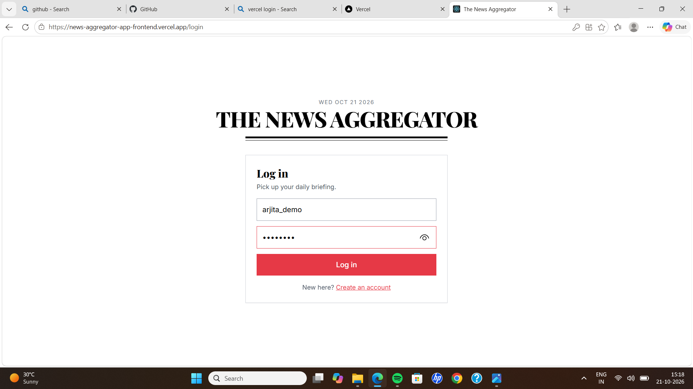
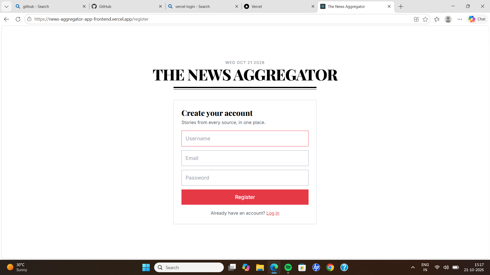
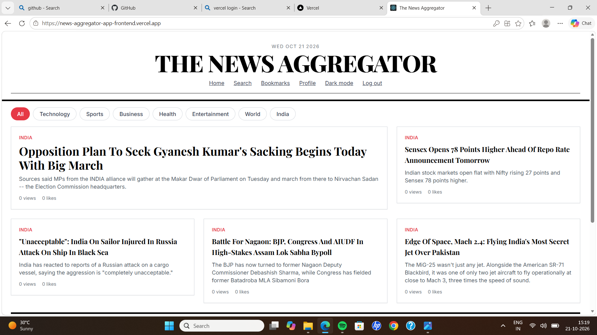
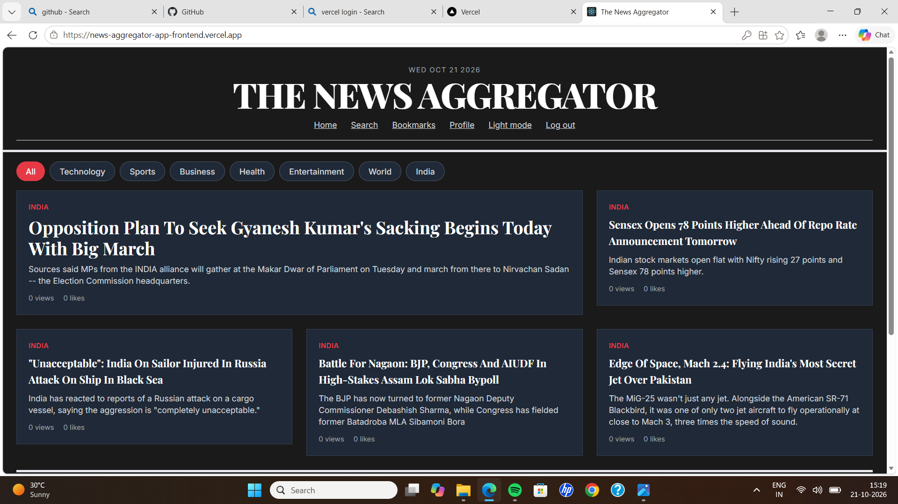
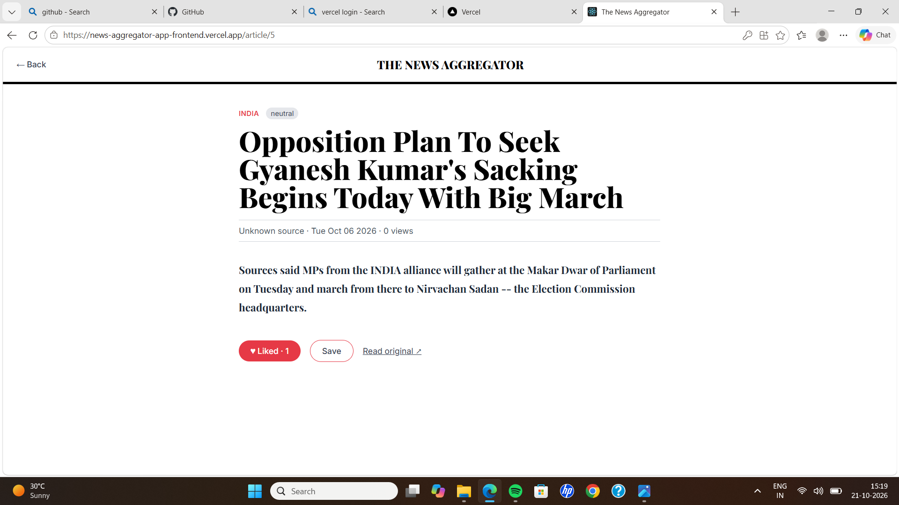
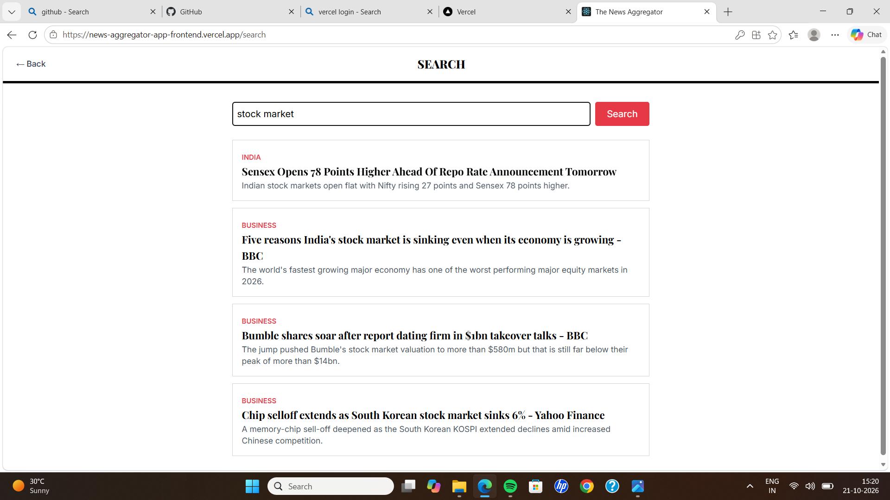
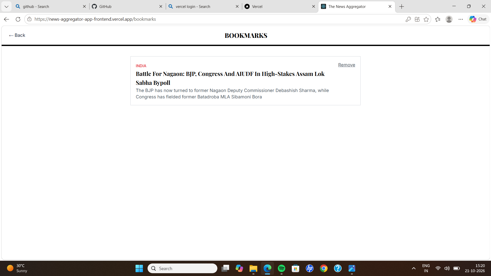

# The News Aggregator (Frontend)

A newspaper-style news app built with React, TypeScript and Tailwind CSS.

**Live demo:** https://news-aggregator-app-frontend.vercel.app
**Demo video:** https://drive.google.com/file/d/1p2YFMguiba8GakaYqB22wwNL6QjKa1m8/view?usp=drive_link

> The backend runs on a teammate's laptop through ngrok, so the live demo works only while it is online. The demo video shows the full flow.

## Screenshots

### Login





### Register





### Home (light mode)





### Home (dark mode)





### Article





### Search





### Bookmarks





## Features
- JWT login and registration with protected routes
- Trending feed with category filters
- Article detail with like and bookmark
- Search, bookmarks and profile pages
- Dark and light mode
- Loading, error and offline fallback states

## Tech stack
React, TypeScript, Tailwind CSS, React Router, Axios (token interceptors), Vercel

## Run locally
```
npm install
npm start
```
Set `REACT_APP_API_URL` to the backend URL for deployment.

## My contribution
Built the entire frontend: UI, routing and protected routes, Axios integration with token handling, dark mode and Vercel deployment. The core REST API (Spring Boot, Kafka, Redis, Docker) was built by my teammate.